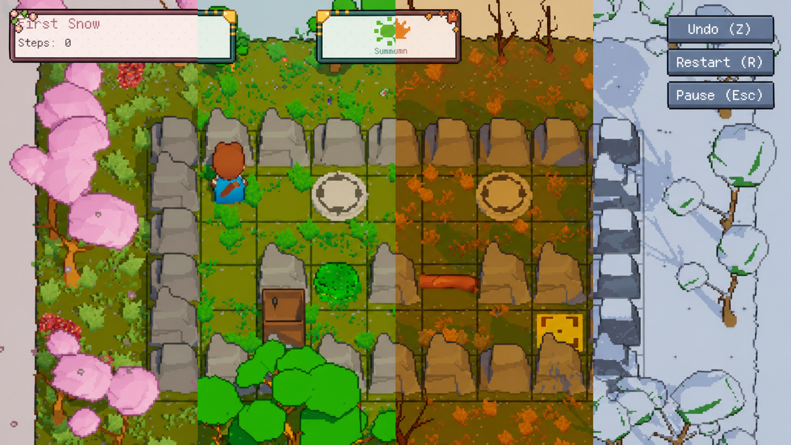
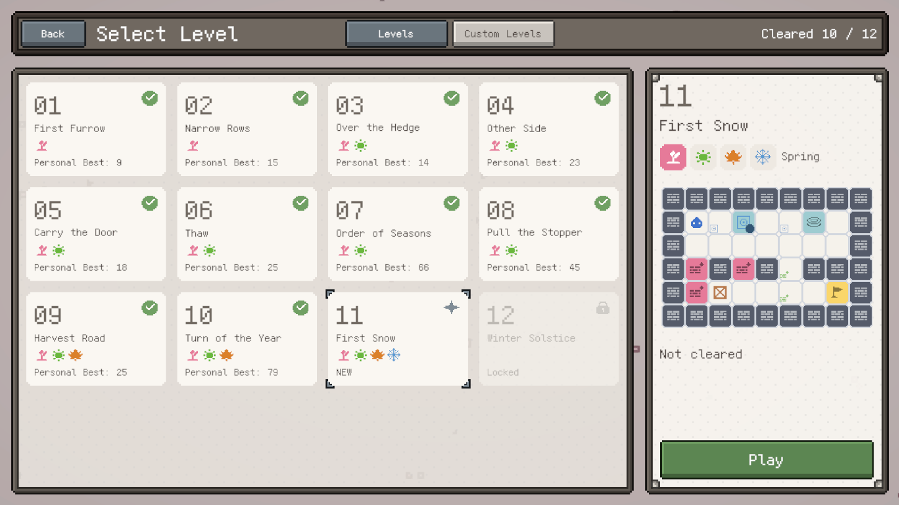
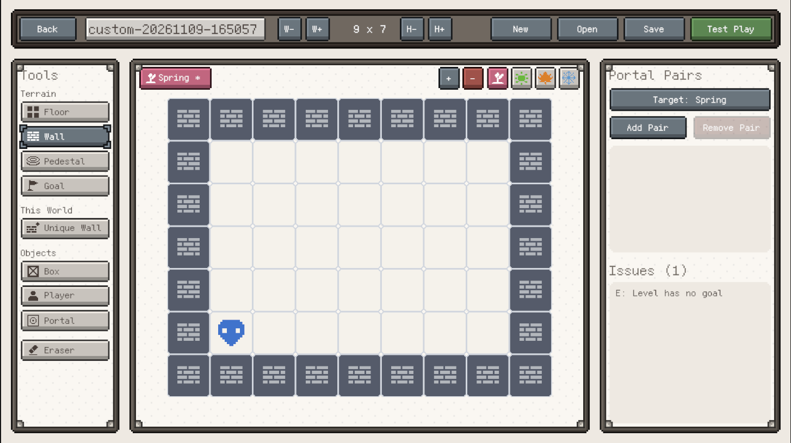

# Worldyssey

> **English summary** — *Worldyssey* is a 3D grid-based Sokoban puzzle game built in Unity 2022.3 (URP). Each level spans up to four overlapping seasonal worlds: goal boxes are mirrored across every world, while walls and portal boxes belong to only one. Players hop between worlds through paired portal boxes to push every box onto its goal. The project includes 12 handcrafted levels, an in-game level editor with automatic solvability checking, a pure C# rules core covered by 250+ unit tests, and a one-click editor toolchain that builds scenes, UI and content.

<!-- 首图：建议放一张 16:9 的游戏画面或 GIF，例如 Docs/Media/hero.gif -->


**Worldyssey** 是一款 3D 网格推箱子解谜游戏。每一关由最多四个“季节世界”叠在一起：目标箱子在所有世界里同步存在，墙和传送箱子却只属于某一个世界。玩家要在春夏秋冬之间来回穿梭，利用每个世界不同的地形，把箱子推到终点。

- **引擎**：Unity 2022.3.51f1 · URP · Input System
- **平台**：PC（键盘操作，鼠标操作界面和关卡编辑器）
- **语言**：简体中文 / English
- **详细设计与实现**：见 [Wiki](https://github.com/lrysn000/Worldyssey/wiki)

---

## 核心玩法

<!-- GIF：一次完整的传送（钻进箱子 → 截图缩放 → 新世界展开），Docs/Media/teleport.gif -->


| 规则 | 说明 |
| --- | --- |
| 目标箱子跨世界映射 | 在任何一个世界推动目标箱子，所有世界里的它都同步移动 |
| 独有墙 | 只存在于某个世界的墙；换一个世界，路可能就通了 |
| 传送箱子与配对 | 每对传送箱子连接两个世界。面朝底座上的传送箱子按 F，就会进入另一个世界，同一坐标出现 |
| 伙伴跟随 | 传送时，另一侧的伙伴箱子会被生成或拉到你身后的底座上：每对在每个世界最多一个，留下的门会跟着你走 |
| 世界冲突 | 如果目标箱子和某个世界的独有墙或传送箱子重叠，那个世界就“冲突”了，进不去，必须先在别的世界把箱子推开 |

撤销可以回退任意一步（包括传送）；传送和转身不计步。每关记录你的最少步数（Personal Best），鼓励反复优化。

## 内容

- **12 个正式关卡**，按季节分为 6 章，从单世界推箱逐步引入独有墙、传送、伙伴跟随、冲突和四世界联动
- **新手教学**：前几关在引入新概念时显示不打断操作的提示条，并在玩家卡关时给出提示；只在首次通关前出现
- **游戏内关卡编辑器**：多世界分层绘制、传送配对管理、实时校验、试玩；保存前自动检查关卡是否可解，无解的关卡不能保存
- **四季视觉**：每个世界一套季节环境、地面图案和环境音；冬季下雪、草地随角色摆动
- **双语界面**：设置中切换简体中文 / English

<!-- 截图：选关界面、关卡编辑器、四季对比，各一张 -->
| 选关 | 关卡编辑器 |
| --- | --- |
|  |  |

## 操作

| 操作 | 按键 |
| --- | --- |
| 移动 / 推箱 | WASD 或方向键 |
| 传送 | F（面朝底座上的传送箱子） |
| 旋转视角 | Q / E |
| 撤销 / 重开 | Z / R |
| 暂停 | Esc |

## 技术亮点

**规则与表现分离**
全部游戏规则写在纯 C# 的 Core 程序集里（`LevelRules`、`LevelState`），不依赖场景和 MonoBehaviour。规则层输入“状态 + 操作”，输出“新状态 + 事件列表”，表现层只按事件播放动画。撤销是整体状态快照，因此传送、伙伴跟随这类复杂操作也能精确回退。

**可解性检查**
关卡编辑器和编辑器菜单共用同一个求解器，直接调用游戏规则搜索，规则改了检查结果自动跟着变。搜索只展开“推箱”和“传送”两类会改变局面的操作，并把玩家能自由走动的区域合并为一个局面，最复杂的正式关卡也只需搜索几万个局面。

**数据驱动与校验**
关卡是可读的 JSON（地形用字符行），内置关卡导入为 ScriptableObject，与编辑器共用同一套数据类型。校验器一次列出全部问题并标出坐标；提示文字以“模板 + 参数”记录，界面上按当前语言显示。

**编辑器工具链**
70 余个编辑器脚本，按“关卡 / 内容 / 美术 / 场景搭建 / 调试”分组：一键生成整套 UI、相机、转场、季节环境、角色预制体与动画控制器、教学数据和多语言字体字符集。场景和资源都由工具生成，不手改 `.unity` / `.prefab` 文件，可以重复运行。

**表现**
截图式传送转场（截取当前画面投影到箱子上，再缩放展开新世界）、卡通着色与描边后处理、季节环境与天空、草地交互、底座与终点刻纹发光、角色行走与动作动画。

**测试**
250 余个 EditMode 单元测试，覆盖移动推箱、跨世界传送与冲突、撤销、关卡校验、JSON 往返、存档、编辑器模型和求解器。

## 项目结构

```
Assets/Worldyssey/
  Scripts/
    Core/         纯 C# 规则层（独立 asmdef）：规则、状态、事件、校验、序列化、存档、编辑模型、求解器
    Data/         ScriptableObject 配置（关卡、玩法数值、教学、界面主题）
    Gameplay/     流程控制：关卡会话、输入、界面流程、教学
    View/         3D 表现：实体与动画、相机、传送转场、季节环境、天空
    UI/           界面：菜单、HUD、选关、关卡编辑器、本地化、主题
    Audio/        音乐、音效
    Rendering/    风格化后处理
    Editor/       编辑器工具（Levels / Content / Art / UI / SceneSetup / Debug）
  Tests/EditMode/ 单元测试
  Levels/         内置关卡（Source/ 下为 JSON 源文件）
  Config/  Prefabs/  Art/  Audio/  Shaders/  Localization/  ThirdParty/
```

## 运行

1. 使用 **Unity 2022.3.51f1** 打开项目根目录
2. 打开 `Assets/Worldyssey/Scenes/Main.unity`，点击运行
3. 单元测试：Window → General → Test Runner → EditMode → Run All

## 致谢与第三方素材

<!-- 请核对每个素材包的名称、作者和授权方式 -->
- 角色：[KayKit Adventurers](https://kaylousberg.com)（Kay Lousberg，CC0）
- 植物与环境：CS Stylized Plant Pack、LowPolyTerrain - Mesa、SimpleSky
- 界面：Honeti Pixel Art GUI / Ultimate Flat GUI、Pixel UI
- 音效与音乐：<!-- 填写来源 -->

第三方素材版权归原作者所有，仅用于本作品展示。

## 作者

Shuoze Sun <!-- 可加中文名、邮箱、作品集链接 -->
